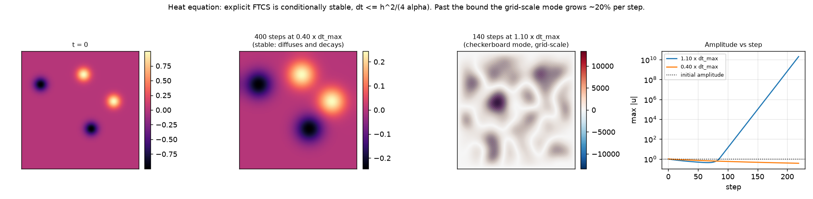
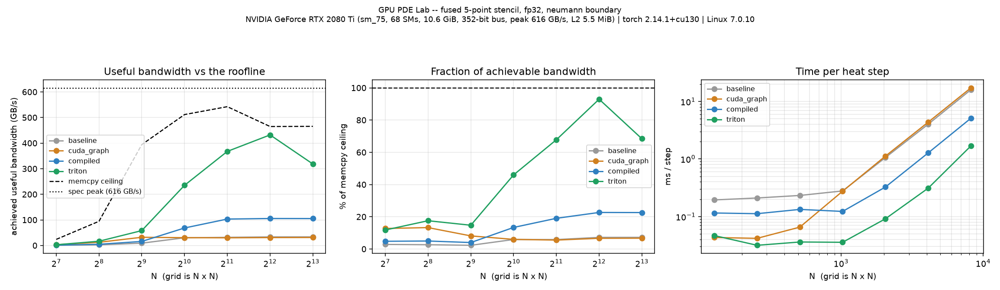
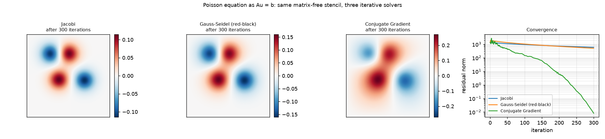
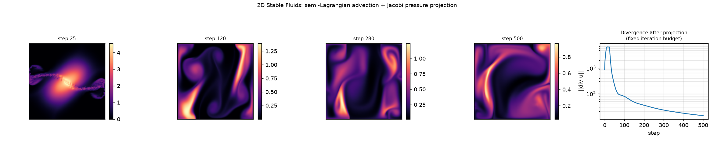
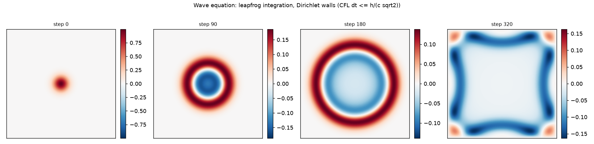

# GPU PDE Lab

[](https://github.com/LuxKaiwalker/gpu-pde-lab/actions/workflows/ci.yml)
[](https://www.python.org/)
[](LICENSE)

Finite-difference PDE solvers written from scratch, an interactive lab to drive them,
and a measurement of how much of a GPU they actually use.

Every stencil, time-stepper and iterative linear solver here is implemented in plain
array operations. PyTorch is an execution engine, not a PDE library — there are no
calls into a pre-built CFD or PDE package anywhere in this repository.



## The short version

The obvious way to write a 5-point stencil in PyTorch reaches **7% of this GPU's
achievable memory bandwidth**. A hand-written fused Triton kernel computing the
identical update reaches **93%**, which is **4.2–12.9× faster** depending on grid size.



| | what it is | kernels/step | array passes/step | best speedup |
|---|---|---|---|---|
| `baseline` | eager shifted-slice arithmetic | 17 | ~33 | 1.00× |
| `cuda_graph` | the same ops captured and replayed as one submission | 18 | ~33 | 5.03× |
| `compiled` | `torch.compile` max-autotune | 4 | fused | 3.25× |
| `triton` | hand-written fused kernel, boundary folded in | **1** | **2** | **12.91×** |

A 5-point stencil is memory-bound — about 6 flops per 8 bytes moved — so the only
question that matters is what fraction of bandwidth you get. The eager version loses
it by making every intermediate a full-sized tensor with its own round trip to memory:
measured at the dispatch layer, ~33 array passes where one read and one write would do.

The two optimized implementations fix different things, which is why both are kept:

- `cuda_graph` removes **launch overhead** and nothing else. It wins 5× at N=128 and
  *loses* (0.92×) at N≥1024.
- `triton` removes the **memory traffic**. It wins everywhere and wins biggest where
  the grid no longer fits in L2.

Measuring both separates two bottlenecks that look identical in a wall-clock number
and have completely different fixes.

Full numbers, including the raw CSV and the device they were measured on:
**[`docs/results/roofline.md`](docs/results/roofline.md)**.
Reproduce with `python scripts/run_roofline.py`.

## Try it without installing anything

[](https://colab.research.google.com/github/LuxKaiwalker/gpu-pde-lab/blob/main/notebooks/gpu_pde_lab_colab.ipynb)

Runs the convergence study, the CPU-vs-GPU crossover and the roofline sweep on a free
T4. No Nix, no Qt, no local setup.

## What's in here

Twelve interactive experiments in one desktop app, in three groups.

**PDE simulations** — Heat (2D and 3D), Wave, Poisson, 2D Fluid, and a cell-by-cell
stencil inspector.

**GPU experiments** — CPU vs GPU, host↔device transfer, memory, and kernel/vectorization
comparison.

**Numerical analysis** — resolution/convergence, and an fp16/fp32/fp64 precision comparison.

Every experiment ships an explanation panel answering the same six questions: what PDE
is this, how is it discretized, what does one grid cell compute, why can it run in
parallel, what does the GPU actually do, and what can go wrong.

| | |
|---|---|
|  | |
| **Poisson as `Au = b`.** Jacobi, red-black Gauss-Seidel and Conjugate Gradient on the same matrix-free stencil. CG converges five orders of magnitude while the other two barely move — and all three bottom out in the same kernel. | |
|  | |
| **2D Stable Fluids.** Operator-split incompressible Navier-Stokes: Jacobi diffusion, pressure projection via a Poisson solve, semi-Lagrangian advection with bilinear backtracing. | |
|  | |
| **Wave equation.** Leapfrog integration with a CFL bound that is linear in `h`, unlike the heat equation's quadratic one. | |

More: [`docs/figures/`](docs/figures/) — 3D heat slices, measured convergence order,
and the stencil diagram. All of it regenerated by `python scripts/make_figures.py`,
which runs the solvers rather than taking screenshots.

## The thing the stability figure shows

Explicit FTCS is only *conditionally* stable: von Neumann analysis gives
`dt <= h²/(4α)`. Past that bound the highest frequency the grid can represent — the
cell-to-cell checkerboard — is amplified about 20% per step at 1.10× the bound.

There is a subtlety worth knowing, and the figure at the top is built to show it. A
smooth initial condition contains almost none of that mode, so an over-the-bound run
*looks* fine for ~80 steps: there is nothing at the unstable frequency to amplify until
round-off seeds it. Then it grows to 10¹⁰ in the next 140.

Running the same unstable configuration on a faster GPU does not fix it. It reaches
`inf` sooner.

## Install

The project is three installable pieces. The solver core depends only on NumPy and
PyTorch, so you can use the numerics as a library without pulling in Qt:

```bash
pip install -e .            # solver core: core/, pdes/, kernels/, benchmarking/
pip install -e ".[lab]"     # + the desktop app (PySide6, pyqtgraph)
pip install -e ".[bench]"   # + figures and benchmark plots (matplotlib)
pip install -e ".[all]"     # everything
```

### NixOS (the developed-on path)

```bash
nix develop
```

The flake wires up CUDA, the nixpkgs-built PySide6, and the two environment variables
that are otherwise easy to lose a day to: `QT_QPA_PLATFORM=xcb` (the nixpkgs Qt build
aborts on native Wayland) and `TRITON_LIBCUDA_PATH` (Triton locates `libcuda.so.1` by
shelling out to `/sbin/ldconfig`, which NixOS does not have).

### Docker

```bash
docker build -t gpu-pde-lab .
docker run --rm --gpus all gpu-pde-lab                       # what can this machine run?
docker run --rm --gpus all gpu-pde-lab python scripts/run_roofline.py
```

Needs `nvidia-container-toolkit` for the GPU. Headless; see the Dockerfile for the
GUI caveat.

## Run

```bash
python -m gpu_pde_lab.app              # the desktop lab
python scripts/run_roofline.py         # measure against the memory roofline
python scripts/count_kernels.py        # kernel launches and array passes, measured
python scripts/run_benchmark.py        # headless CPU-vs-GPU sweep
python scripts/make_figures.py         # regenerate docs/figures (no GPU needed)
pytest -q                              # 162 tests
```

No GPU? Everything still runs. The CUDA-specific comparisons report that no usable
device was found and say why — including the case where a device exists but another
process is holding its memory, which is a different problem from not having one.

## Layout

```
src/gpu_pde_lab/
  core/          grid (2D + 3D), backend abstraction, boundary conditions,
                 the shared 5- and 7-point stencils, bilinear interpolation,
                 field editing, config save/load (no pickle)
  pdes/          HeatEquation, HeatEquation3D, WaveEquation, PoissonProblem,
                 StableFluids2D -- no Qt import anywhere, enforced by a test
  kernels/       four implementations of one heat step: eager, CUDA graph,
                 torch.compile, hand-written Triton
  benchmarking/  CUDA-safe timing, bandwidth, memory, convergence, roofline
  experiments/   UI-facing parameter state; delegates all numerics to core/pdes
  ui/            PySide6 window and pyqtgraph views -- no numerics live here
scripts/         roofline, kernel counting, benchmarks, figure generation
docs/figures/    generated figures
docs/results/    committed measurements + raw CSV
notebooks/       Colab notebook
tests/           162 tests
```

**Backend abstraction.** `core/backend.py` wraps NumPy or PyTorch (CPU or CUDA) behind
one small method set. Every PDE is written once and runs unmodified on any backend —
`HeatEquation(grid, Backend(BackendSpec("torch", "cuda", "fp32")), ...)` and the same
call with `("numpy", "cpu", "fp64")` execute the identical Python. That is what makes
the CPU-vs-GPU and precision comparisons meaningful rather than two different programs.

**Solver/visualization separation.** `tests/test_regression_separation.py` asserts that
displaying a field never mutates solver state and that re-reading it never advances the
simulation.

## Correctness

The performance numbers are only worth anything if the thing being timed is right.

- Laplacian of a quadratic is exact; measured spatial convergence order 1.7–2.3 against
  a closed-form analytical solution
- Neumann boundaries conserve total heat; pressure projection reduces divergence; CG
  agrees with Jacobi at convergence
- Every optimized kernel is checked against the eager baseline at every boundary
  condition, both precisions, and deliberately ragged non-power-of-two grids
- The eager reference in `kernels/baseline.py` is asserted **bit-identical** to
  `pdes/heat.py`, so the duplicate cannot silently drift from what it represents
- `ruff` and `mypy` clean; `mypy` is scoped to `core/`, `kernels/` and `benchmarking/`
  — see the note in `pyproject.toml` for what is not yet covered and why

One bug worth recording, because it would have been invisible: **Triton binds a Python
`float` kernel argument as fp32.** Passing `dx²`, `dy²` and `dt·α` as scalars silently
truncated them, so an fp64 field was being stepped with single-precision coefficients
and carried ~1e-8 relative error. That would have quietly corrupted the very precision
comparison this project exists to make. The coefficients now travel in a tensor of the
field's own dtype, and `test_triton_keeps_fp64_in_fp64` holds it there.

## Known limitations

- 3D covers Heat only. Wave, Poisson and Fluid remain 2D; extending each needs its own
  numerical work (a 3D CFL bound, a 3D Poisson operator, trilinear advection) rather
  than reusing the existing one.
- The Poisson and fluid pressure solves use a fixed iteration budget for interactivity
  rather than solving to convergence. The residual and divergence plots make the
  approximation visible instead of hiding it.
- Array-pass counts are *requested* traffic measured at the dispatch layer, not DRAM
  transactions. They are an upper bound, tight only once the field exceeds L2.
- `Grid2D.dx/dy` use `lx/(nx-1)` spacing uniformly, including for periodic domains
  where `lx/nx` is more conventional. Deliberate; it does not affect the convergence
  results.
- Explanation panels render Markdown through `QTextBrowser`, which has no LaTeX
  support, so `$$...$$` shows as literal text in the app. The notebook and `doc.md`
  render it properly.
- Save/load round-trips edited fields, grid dimensions and boundary condition, but not
  the PDE's scalar parameters.

## Documentation

- **[`doc.md`](doc.md)** — the full technical reference: discretizations, stability
  derivations, the architecture, and how to add a PDE or a backend
- **[`docs/results/roofline.md`](docs/results/roofline.md)** — measurements with the
  device and versions they were taken on
- **[`notebooks/`](notebooks/)** — the Colab notebook

## License

MIT — see [`LICENSE`](LICENSE).
